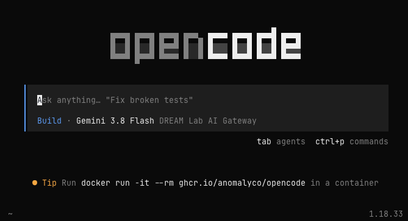
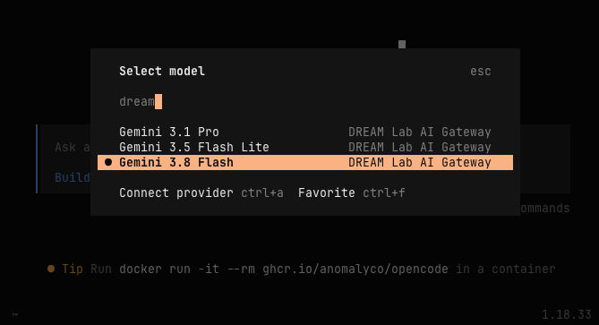

---
# This guide demonstrates how to safely use autonomous coding agents like OpenCode in Coder.
title: "Using AI Coding Agents"
---

Experiment safely with autonomous and interactive coding agents like OpenCode inside isolated Coder virtual machines connected to UCSB AI Gateways.

## Why Use Coder for AI Coding Agents?

Coder workspaces provide a relatively safe way to experiment with AI coding agents like [OpenCode](https://opencode.ai), Claude Code, or OpenAI Codex. These tools, which generate and also *execute* code, are powerful, but they come with significant risks such as prompt injection or unintended file modifications.

Because Coder workspaces are isolated virtual machines, the potential damage a rogue AI agent can cause is contained and cannot harm your personal laptop or campus network.

---

## OpenCode

OpenCode is an open-source coding agent that works with a wide range of AI services and model providers. It is preinstalled on all Coder Workspaces.

To launch OpenCode, run `opencode` in your workspace terminal:

```bash
opencode
```



::: {.callout-tip}
## Switching Models in OpenCode
Inside OpenCode, type `/models` to search and select a model from your preferred model provider.
:::

---

## Campus AI Gateways

By default, OpenCode offers default cloud services. For data privacy and university compliance, we recommend routing requests through campus gateways:

### 1. College IT (CIT) AI Gateway

The [College IT AI Gateway](https://docs.cloud.college.ucsb.edu/AI-LLM) provides on-premises Large Language Model access for UCSB staff and faculty; incidental student use is supported. All inference runs directly on CIT hardware, and prompts stay on campus.

In OpenCode, run `/models` and filter for **"CIT"**.

### 2. DREAM Lab AI Gateway

The [DREAM Lab AI Gateway](../ai-gateway.qmd) provides access to Google Gemini models through an OpenAI-compatible endpoint.

To use it, generate a key at the [API Key Manager ↗](https://litellm.dreamlab.ucsb.edu/dreamlab-keys) (UCSB NetID login required).

Configure OpenCode using one of two methods:

- Provide the key in the **DREAM Lab LLM API Key** field when creating your workspace.
- Or export the environment variable manually before launching:

```bash
export DREAMLAB_LLM_KEY=sk-...
opencode
```

Then run `/models` inside OpenCode and filter for **"DREAM Lab"**:


