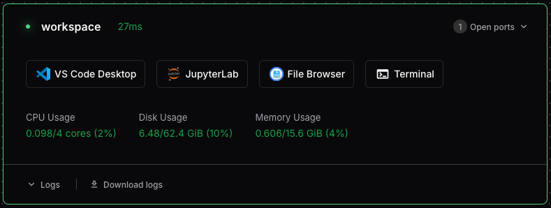
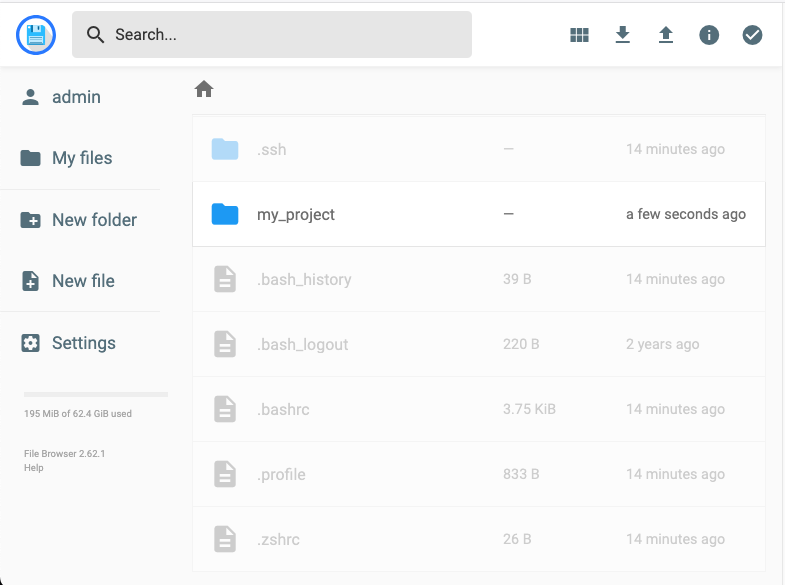

```{=html}
<div class="doc-hero">
  <div class="site-grid">
    <nav class="breadcrumbs" aria-label="Breadcrumb">
      <a href="../index.html">Cloud Services</a>
      <span aria-hidden="true">/</span>
      <a href="index.html">Guides</a>
      <span aria-hidden="true">/</span>
      <span aria-current="page">Transferring Files</span>
    </nav>
    <div class="doc-hero__heading">
      <div>
        <p class="eyebrow">Guide</p>
        <h1>Transferring files to/from your Workspace</h1>
        <p>
          Learn how to move files, scripts, and datasets into and out of your Coder environment using the Web File Browser, Magic Wormhole, or Google Drive via Rclone.
        </p>
      </div>
      <span class="hexagon-motif" aria-hidden="true"><i></i><i></i><i></i></span>
    </div>
  </div>
</div>

<div class="docs-sidebar">
  <nav aria-label="Guides navigation">
    <p class="docs-sidebar__title">All Guides</p>
    <a href="getting-started.html"><span>01</span>Getting Started</a>
    <a href="file-transfer.html" class="is-current" aria-current="page"><span>02</span>Transferring Files</a>
    <a href="rstudio.html"><span>03</span>RStudio Server</a>
    <a href="marimo.html"><span>04</span>Marimo Notebooks</a>
    <a href="ai-agents.html"><span>05</span>Using AI Coding Agents</a>
    <a href="ai-commons.html"><span>06</span>UCSB AI Commons API</a>
  </nav>
  <div class="sidebar-help">
    <strong>Need help?</strong>
    <p>
      Email <a href="mailto:dreamlab@library.ucsb.edu">dreamlab@library.ucsb.edu</a> for assistance with large data transfers.
    </p>
  </div>
</div>
```

::: {.doc-intro #overview}
<p class="doc-kicker">Methods Overview</p>

## Three Ways to Transfer Files

There are several ways to upload and download files to a Coder Workspace:

- **Coder's built-in File Browser:** The most straightforward visual option.
- **Magic Wormhole:** Fast and convenient for moving files or project folders between machines or workspaces.
- **Rclone:** Connects your workspace directly to your UCSB Google Drive.
:::

::: {.doc-step #file-browser}
::: {.doc-step__number}
1
:::
::: {.doc-step__body}
<p class="doc-kicker">Visual File Management</p>

## Coder File Browser

The most convenient way to transfer files to/from a Coder Workspace is to use the built-in File Browser, accessible directly from the workspace dashboard.



Clicking the **File Browser** button from the workspace dashboard opens the File Browser in a new tab or window. (Ensure popups are enabled in your browser settings).


:::
:::

::: {.doc-step #magic-wormhole}
::: {.doc-step__number}
2
:::
::: {.doc-step__body}
<p class="doc-kicker">Direct Machine-to-Machine</p>

## Magic Wormhole

[Magic Wormhole](https://magic-wormhole.readthedocs.io/en/latest/) is a command-line utility that makes it easy to send files and directories directly between two machines using a short, one-time code. No accounts, cloud servers, or SSH keys required — just run a command on each machine and the transfer happens over an end-to-end encrypted channel.

You can use Magic Wormhole without installation by running it with `uvx`, which executes Python tools in temporary environments. `uvx` is installed on all Coder Workspaces by default.

### Sending a file or directory:

```bash
uvx magic-wormhole send ./myfile.txt
# or for a directory:
uvx magic-wormhole send ./my-project
```

Magic Wormhole will print a short one-time code such as `7-guitarist-revenge`. Use that code on the receiving machine:

### Receiving a file or directory:

```bash
uvx magic-wormhole receive 7-guitarist-revenge
```

```{=html}
<div class="doc-callout doc-callout--tip">
  <span class="doc-callout__icon" aria-hidden="true">i</span>
  <div>
    <strong>Single-Use Codes</strong>
    <div><p>The code is single-use and expires as soon as the transfer completes or is cancelled. This is a quick and secure way to migrate projects between Coder workspaces!</p></div>
  </div>
</div>
```
:::
:::

::: {.doc-step #rclone-gdrive}
::: {.doc-step__number}
3
:::
::: {.doc-step__body}
<p class="doc-kicker">Cloud Storage Mount</p>

## Rclone: Connecting to Google Drive

[Rclone](https://rclone.org/) is a powerful file transfer tool that can mount your Google Drive to a local directory (such as `~/gdrive`) in your workspace.

```{=html}
<div class="doc-callout doc-callout--note">
  <span class="doc-callout__icon" aria-hidden="true">ℹ</span>
  <div>
    <strong>Desktop VS Code Required for Auth</strong>
    <div><p>Initial authorization requires connecting to your workspace using the <strong>VS Code Desktop application</strong> so that browser authorization tokens can be forwarded to Rclone. Once configured, VS Code Desktop is no longer needed.</p></div>
  </div>
</div>
```

1. Connect to your workspace using desktop VS Code (click the VS Code Desktop icon on the dashboard).
2. In VS Code, open a Terminal (`View → Terminal` or `Ctrl+\``).
3. Verify Rclone is installed, or install it:
   ```bash
   sudo apt update && sudo apt install rclone
   ```
4. Authorize read-only access to your Google Drive:
   ```bash
   rclone config create gdrive drive scopes drive.readonly
   ```
   *(For full read-write permissions, omit `scopes drive.readonly`)*.
5. A web browser tab will open. Grant Rclone permission to access your Google Drive. Once finished, return to the VS Code terminal.
6. Create a mount point folder:
   ```bash
   mkdir ~/gdrive
   ```
7. Mount Google Drive in the background:
   ```bash
   rclone mount gdrive: ~/gdrive --daemon
   ```
8. Confirm that you can view files in your Drive:
   ```bash
   ls ~/gdrive
   ```

To disconnect your Google Drive folder when done, run:

```bash
umount ~/gdrive
```

If `umount` reports a busy device, ensure no files are open and your terminal is not currently inside the `~/gdrive` directory.
:::
:::

```{=html}
<nav class="doc-pagination" aria-label="Guide pagination">
  <a href="getting-started.html">
    <span>Previous</span>
    <strong>Getting Started</strong>
  </a>
  <a href="rstudio.html" class="doc-pagination__next">
    <span>Next</span>
    <strong>RStudio Server</strong>
  </a>
</nav>
```
