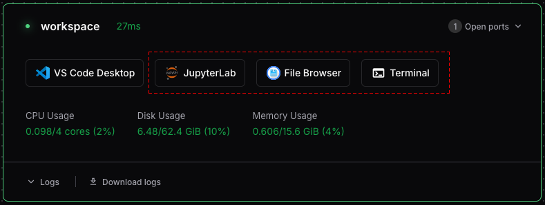

```{=html}
<div class="doc-hero">
  <div class="site-grid">
    <nav class="breadcrumbs" aria-label="Breadcrumb">
      <a href="../index.html">Cloud Services</a>
      <span aria-hidden="true">/</span>
      <a href="index.html">Guides</a>
      <span aria-hidden="true">/</span>
      <span aria-current="page">Getting Started</span>
    </nav>
    <div class="doc-hero__heading">
      <div>
        <p class="eyebrow">Guide</p>
        <h1>Getting Started with Coder Workspaces</h1>
        <p>
          Welcome to Coder! This guide will help you create your first workspace and connect to it using browser tools or local IDEs.
        </p>
      </div>
      <span class="hexagon-motif" aria-hidden="true"><i></i><i></i><i></i></span>
    </div>
  </div>
</div>

<div class="docs-sidebar">
  <nav aria-label="Guides navigation">
    <p class="docs-sidebar__title">All Guides</p>
    <a href="getting-started.html" class="is-current" aria-current="page"><span>01</span>Getting Started</a>
    <a href="file-transfer.html"><span>02</span>Transferring Files</a>
    <a href="rstudio.html"><span>03</span>RStudio Server</a>
    <a href="marimo.html"><span>04</span>Marimo Notebooks</a>
    <a href="ai-agents.html"><span>05</span>Using AI Coding Agents</a>
    <a href="ai-commons.html"><span>06</span>UCSB AI Commons API</a>
  </nav>
  <div class="sidebar-help">
    <strong>Need help?</strong>
    <p>
      Email <a href="mailto:dreamlab@library.ucsb.edu">dreamlab@library.ucsb.edu</a> or join the UCSB Carpentry Slack.
    </p>
  </div>
</div>
```

::: {.doc-intro #overview}
<p class="doc-kicker">Quick Overview</p>

## What to expect

Anyone with an active UCSB NetID can create an isolated cloud workspace running Ubuntu Linux with data science tools like Python, R, Docker, and Pixi pre-configured.

```{=html}
<ul class="check-list">
  <li>Log in with UCSB Google Single Sign-On</li>
  <li>Boot an environment in 2-3 minutes</li>
  <li>Work in your browser or connect with your local desktop tools</li>
</ul>
```
:::

::: {.doc-step #create-workspace}
::: {.doc-step__number}
1
:::
::: {.doc-step__body}
<p class="doc-kicker">Step 1</p>

## Creating a Workspace

1. Visit [https://coder.dreamlab.ucsb.edu](https://coder.dreamlab.ucsb.edu).
2. Click **UCSB Login** and log in using UCSB SSO (via Google).
3. Click the **New Workspace** button.
4. On the **New Workspace** page:
   - Give the workspace a **name** (required).
   - Check **I understand the usage policies** (required).
   - Select additional software and workspace options to enable (see below).
   - Click **Create Workspace**.
5. It may take a couple of minutes for the workspace to boot.

### New Workspace Options

When creating a workspace, you can configure:

- **RStudio**: Enables the RStudio Server system service on port `8787`.
- **JupyterLab**: Installs JupyterLab and commonly used packages (`pip`, `numpy`, `pandas`, `matplotlib`, `ipython`, and `jupyter-ai`) into a global Pixi environment (`coder-jupyter`). Runs in the background on port `19999` with `~/workspace` as the working directory.
- **Visual Studio Code (Desktop)**: Configures the Coder agent to enable desktop VS Code support, surfacing direct connection buttons to launch remote sessions.
- **Visual Studio Code (Web)**: Deploys the browser-based `vscode-web` service rooted at `/home/coder/workspace`.
- **DREAM Lab LLM API Key**: Injects your [DREAM Lab AI Gateway](../ai-gateway.qmd) key into the workspace as `$DREAMLAB_LLM_KEY` for automated OpenCode authentication.
:::
:::

::: {.doc-step #connect-workspace}
::: {.doc-step__number}
2
:::
::: {.doc-step__body}
<p class="doc-kicker">Step 2</p>

## Connecting to Your Workspace

Once your workspace is created, you will be directed to the workspace dashboard. You can interact with your workspace directly through the browser or via software on your local machine.



### Browser-Based Tools

- **JupyterLab or RStudio**: Web-based IDEs for data analysis in Python or R.
- **File Browser**: For navigating your workspace's file system and transferring files.
- **Terminal**: A browser-based terminal that provides instant access to your workspace shell environment.

To use these, simply click the corresponding icon on your workspace's dashboard page.
:::
:::

::: {.doc-step #local-tools}
::: {.doc-step__number}
3
:::
::: {.doc-step__body}
<p class="doc-kicker">Step 3</p>

## Connecting with Locally Installed Software

For a more integrated development experience, connect your local editor or terminal to your Coder workspace.

### Connecting via Desktop VS Code

1. Ensure you have the [Visual Studio Code](https://code.visualstudio.com/) desktop application installed.
2. Install the official **Coder** extension from the VS Code Marketplace.
3. Open the Command Palette (`Ctrl+Shift+P` or `Cmd+Shift+P` on macOS) and run:
   `Coder: Login`
4. Enter your Coder deployment URL: `https://coder.dreamlab.ucsb.edu`
5. After logging in, browse your workspaces in the Coder view on the sidebar, or run `Coder: Open Workspace`.

### Connecting via Coder CLI

The Coder CLI allows authenticating and connecting to workspaces directly from your terminal.

**Installing the Coder CLI (macOS / Linux):**

```bash
curl -L https://coder.com/install.sh | sh
```

For Windows, download and run the installer executable from [Coder's GitHub Releases page](https://github.com/coder/coder/releases).

**Authenticate the CLI:**

```bash
coder login https://coder.dreamlab.ucsb.edu
```

Follow the prompts to complete authentication in your browser.

**Connecting via SSH:**

```bash
coder ssh <workspace-name>
```

```{=html}
<div class="doc-callout doc-callout--tip">
  <span class="doc-callout__icon" aria-hidden="true">i</span>
  <div>
    <strong>Persistence &amp; Lifecycle</strong>
    <div><p>Files stored in your home directory persist when you stop and restart your workspace. Remember that workspaces auto-stop after 4 hours of inactivity and are deleted at the end of each academic quarter.</p></div>
  </div>
</div>
```
:::
:::

```{=html}
<nav class="doc-pagination" aria-label="Guide pagination">
  <a href="../coder-workspaces.html">
    <span>Previous</span>
    <strong>Coder Workspaces Overview</strong>
  </a>
  <a href="file-transfer.html" class="doc-pagination__next">
    <span>Next</span>
    <strong>Transferring Files</strong>
  </a>
</nav>
```
