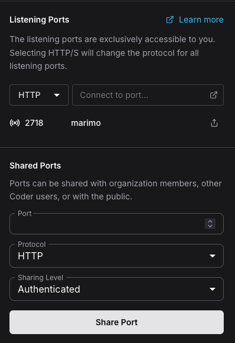
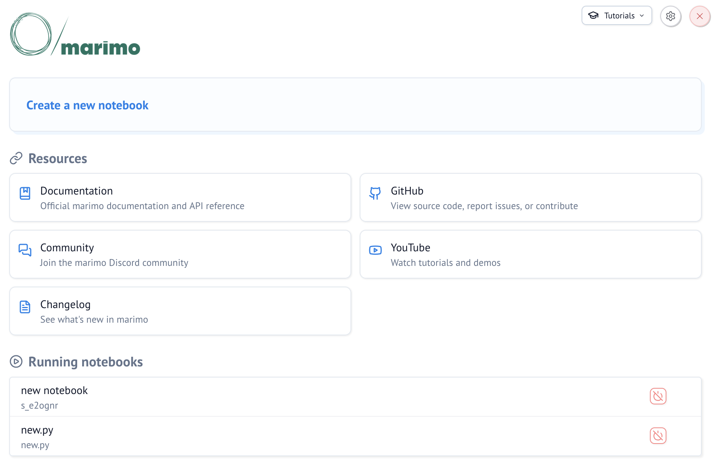
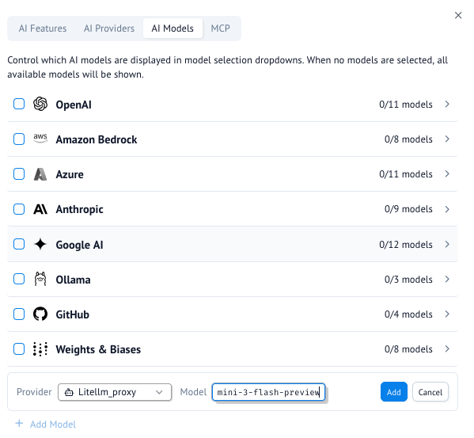
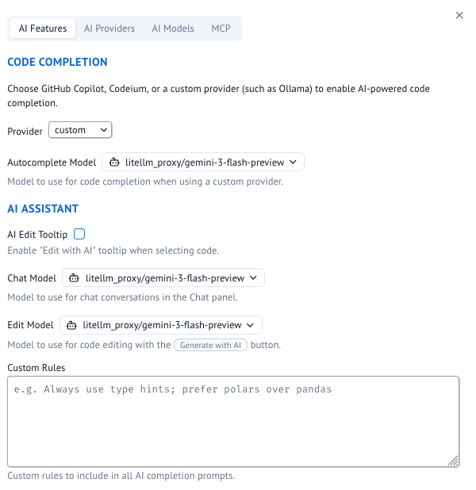
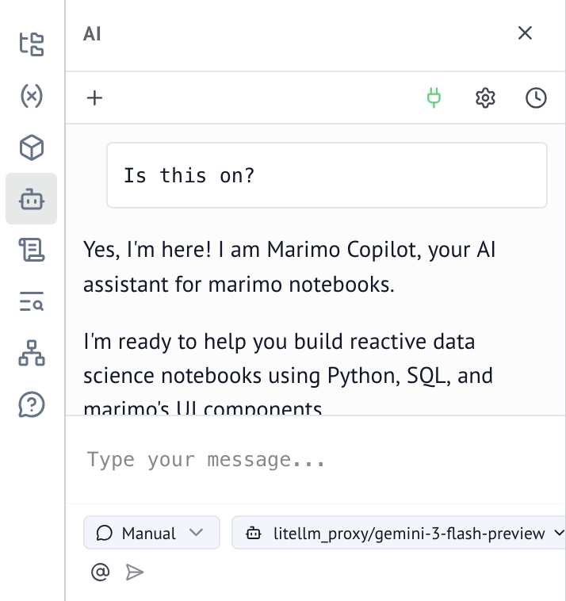

```{=html}
<div class="doc-hero">
  <div class="site-grid">
    <nav class="breadcrumbs" aria-label="Breadcrumb">
      <a href="../index.html">Cloud Services</a>
      <span aria-hidden="true">/</span>
      <a href="index.html">Guides</a>
      <span aria-hidden="true">/</span>
      <span aria-current="page">Marimo Notebooks</span>
    </nav>
    <div class="doc-hero__heading">
      <div>
        <p class="eyebrow">Guide</p>
        <h1>Marimo Notebooks</h1>
        <p>
          Build reactive, reproducible Python notebooks stored as pure Python code, with integrated AI assistants connected to the DREAM Lab AI Gateway.
        </p>
      </div>
      <span class="hexagon-motif" aria-hidden="true"><i></i><i></i><i></i></span>
    </div>
  </div>
</div>

<div class="docs-sidebar">
  <nav aria-label="Guides navigation">
    <p class="docs-sidebar__title">All Guides</p>
    <a href="getting-started.html"><span>01</span>Getting Started</a>
    <a href="file-transfer.html"><span>02</span>Transferring Files</a>
    <a href="rstudio.html"><span>03</span>RStudio Server</a>
    <a href="marimo.html" class="is-current" aria-current="page"><span>04</span>Marimo Notebooks</a>
    <a href="ai-agents.html"><span>05</span>Using AI Coding Agents</a>
    <a href="ai-commons.html"><span>06</span>UCSB AI Commons API</a>
  </nav>
  <div class="sidebar-help">
    <strong>Python Support</strong>
    <p>
      Need help installing libraries or setting up virtual environments? Contact DREAM Lab specialists.
    </p>
  </div>
</div>
```

::: {.doc-intro #overview}
<p class="doc-kicker">Reactive Python</p>

## Overview

Marimo is a modern Python notebook tool. Unlike Jupyter, Marimo notebooks are stored as plain Python files and automatically re-run dependent cells when a cell changes. Marimo has integrated AI chat and agent tools that can be configured to use models through the [DREAM Lab AI Gateway](../ai-gateway.qmd).
:::

::: {.doc-step #install-marimo}
::: {.doc-step__number}
1
:::
::: {.doc-step__body}
<p class="doc-kicker">Step 1</p>

## Creating the Workspace & Installing Marimo

Create a standard workspace at [coder.dreamlab.ucsb.edu](https://coder.dreamlab.ucsb.edu). A default workspace is sufficient (no extra optional software required).

Once booted, open a **Terminal** from the dashboard and run:

```bash
# Create a project folder and set it as your working directory
mkdir my-project
cd my-project

# Create a Python virtual environment with uv
uv venv

# Install marimo in the environment
uv pip install marimo

# Run the marimo server
uv run marimo edit --no-token --headless
```
:::
:::

::: {.doc-step #background-tmux}
::: {.doc-step__number}
2
:::
::: {.doc-step__body}
<p class="doc-kicker">Step 2</p>

## Running Marimo in the Background with tmux

To keep Marimo running after closing your terminal window, use `tmux`:

```bash
# Run in a persistent tmux session
cd ~/my-project
tmux new-session -d -s marimo 'uv run marimo edit --no-token --headless'
```

To stop the background server at any time:

```bash
tmux kill-session -t marimo
```

### Accessing the Marimo Interface

With Marimo running, access the interface through the **Ports** menu on your workspace dashboard:




:::
:::

::: {.doc-step #ai-configuration}
::: {.doc-step__number}
3
:::
::: {.doc-step__body}
<p class="doc-kicker">Step 3</p>

## Configuring Chat and AI Agents

Marimo features integrated AI code generation and assistant chat. You can connect it to models through the [DREAM Lab AI Gateway](../ai-gateway.qmd) using your personal API key.

### 1. Install AI Dependencies

Open **User Settings** (gear icon in the top right). Under **Optional Dependencies**, ensure **AI features** are installed, or click **Install with uv**.

### 2. Add a Custom AI Provider

Under the **AI** panel, go to **AI Providers** and click **Add Provider**:

- **Provider name:** `litellm_proxy`
- **Base URL:** `https://litellm.dreamlab.ucsb.edu`
- **API key:** your personal AI Gateway key

### 3. Add a Model

In the **AI Models** tab, click **+ Add Model**. Choose `litellm_proxy` as the provider, enter `gemini-3-flash-preview`, and click **Add**.



### 4. Configure AI Features to Use the Model

In the **AI Features** tab, set Provider to `custom` and choose your model for **Autocomplete**, **Chat**, and **Edit** models.



### 5. Confirm Chat Interface

Open the **Chat and Agents** UI from the notebook menu to begin prompting.


:::
:::

```{=html}
<nav class="doc-pagination" aria-label="Guide pagination">
  <a href="rstudio.html">
    <span>Previous</span>
    <strong>RStudio Server</strong>
  </a>
  <a href="ai-agents.html" class="doc-pagination__next">
    <span>Next</span>
    <strong>Using AI Coding Agents</strong>
  </a>
</nav>
```
