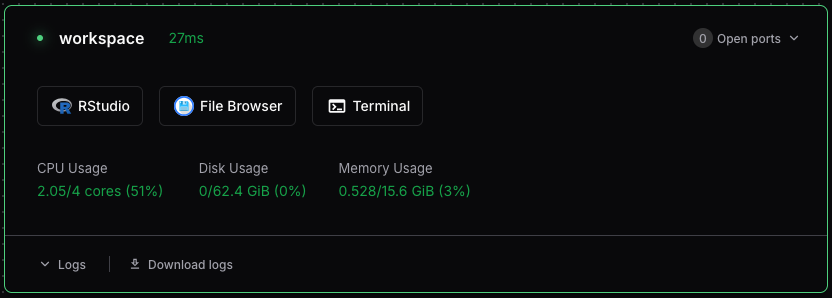

---
# This guide details how to launch and configure RStudio Server in a Coder Workspace.
title: "Getting Started with RStudio"
---

Run RStudio Server directly in your web browser inside an isolated cloud workspace for statistical computing, data visualization, and reproducible research.

## Overview

RStudio is a powerful integrated development environment (IDE) for R programming. Coder workspaces allow you to run RStudio Server, which provides the full RStudio interface accessible securely through any modern web browser.

---

## Step 1: Creating a Workspace with RStudio

::: {.callout-note}
## Enable during creation
RStudio must be enabled when the workspace is created. It cannot be added to an existing workspace after creation.
:::

1. Navigate to the **New Workspace** page at [coder.dreamlab.ucsb.edu](https://coder.dreamlab.ucsb.edu).
2. Complete the required workspace name and policy checks.
3. Make sure **Include RStudio** is set to **Yes**.
4. Click **Create Workspace**.

Once booted, launch RStudio in a new browser tab with the RStudio button on the dashboard:



---

## Step 2: Setting Up an RStudio Project

RStudio Projects organize your scripts, datasets, and working directories cleanly:

1. In RStudio, click **File → New Project**.
2. Select **New Directory**.
3. Choose **New Project**.
4. Enter a directory name (e.g., `my-project`) and keep the parent directory set to `~`.
5. Click **Create Project**.

RStudio generates an `.Rproj` file storing project-specific settings so you can easily resume work.

---

## Step 3: Installing Packages & Git Setup

Install packages in your cloud RStudio session just like a local installation:

```r
# Install from CRAN
install.packages("tidyverse")
install.packages("ggplot2")

# Install from GitHub
install.packages("devtools")
devtools::install_github("username/repository")
```

::: {.callout-tip}
## Isolated Package Storage
Packages installed in your workspace persist across sessions within your persistent home directory, isolated from other workspaces to ensure reproducibility.
:::

### Setting Up Git

Open the Terminal in RStudio (**Tools → Terminal → New Terminal**) and configure your identity:

```bash
git config --global user.name "Your Name"
git config --global user.email "your.email@example.com"
```

### Additional Resources

- [RStudio User Guide ↗](https://docs.posit.co/ide/user/) — Comprehensive documentation.
- [RStudio Cheat Sheets ↗](https://posit.co/resources/cheatsheets/) — Quick syntax and workflow reference.
- [R for Data Science (2e) ↗](https://r4ds.hadley.nz/) — Definitive guide to modern data science in R.
- [Posit Community ↗](https://community.rstudio.com/) — Knowledge sharing and Q&A.
