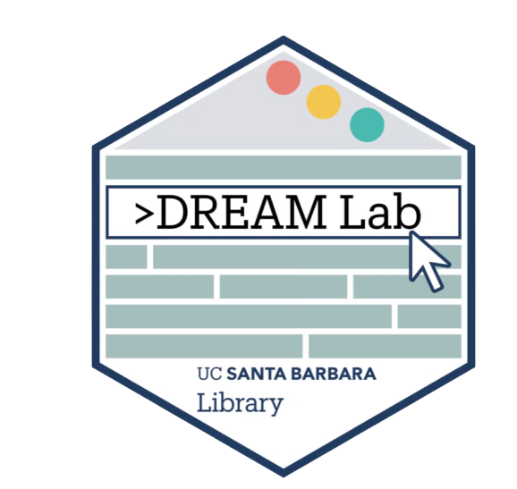

```{=html}
<section class="home-intro">
  <div class="site-grid home-intro__grid">
    <div class="home-intro__content">
      <p class="home-eyebrow">
        <span aria-hidden="true"></span>
        UCSB Library
      </p>
      <h1>
        DREAM Lab<br>
        Cloud Services
      </h1>
      <p class="home-intro__lede">
        Cloud computing services for research and teaching at UC Santa Barbara. Managed by the
        <a href="https://www.library.ucsb.edu/dreamlab" target="_blank" rel="noopener noreferrer">UCSB Library DREAM Lab</a>
        using computing resources provided by the
        <a href="https://www.lsit.ucsb.edu" target="_blank" rel="noopener noreferrer">College of Letters and Science IT</a>.
      </p>
      <div class="home-actions">
        <a class="home-button home-button--gold" href="https://coder.dreamlab.ucsb.edu" target="_blank" rel="noopener noreferrer">
          Launch a Workspace ↗
        </a>
        <a class="home-button home-button--outline" href="guides/getting-started.html">
          Getting Started Guide
        </a>
      </div>
    </div>
    <div class="home-intro__visual">
      <div class="dream-badge-frame">
        
      </div>
    </div>
  </div>
</section>

<section class="home-section" id="services">
  <div class="site-grid">
    <div class="home-section__heading">
      <div>
        <p class="home-eyebrow">
          <span aria-hidden="true"></span>
          Cloud services
        </p>
        <h2>What we offer</h2>
      </div>
      <p>
        Flexible tools supported by people who understand research, teaching, and creative practice.
      </p>
    </div>

    <div class="offer-grid">
      <article class="offer-card offer-card--workspace">
        <div class="offer-card__icon">
          <svg viewBox="0 0 48 48" role="img" aria-label="Workspace window">
            <rect x="5" y="8" width="38" height="31" rx="2"></rect>
            <path d="M5 16h38M12 12h1M17 12h1"></path>
            <path d="m16 25 5 4-5 4M25 33h8"></path>
          </svg>
        </div>
        <div class="offer-card__content">
          <h3>Coder Workspaces</h3>
          <p>
            On-demand virtual machines with commonly used data science tools pre-installed. Anyone with a UCSB NetID can create a workspace for the duration of the academic quarter.
          </p>
          <a class="home-link" href="coder-workspaces.html">
            Explore Coder Workspaces
            <span aria-hidden="true">→</span>
          </a>
        </div>
      </article>

      <article class="offer-card offer-card--gateway">
        <div class="offer-card__icon">
          <svg viewBox="0 0 48 48" role="img" aria-label="Connected AI gateway">
            <path d="M24 12v9M13 31l8-5M35 31l-8-5"></path>
            <path d="m24 5 6 3.5v7L24 19l-6-3.5v-7L24 5ZM13 25l6 3.5v7L13 39l-6-3.5v-7l6-3.5ZM35 25l6 3.5v7L35 39l-6-3.5v-7l6-3.5Z"></path>
          </svg>
        </div>
        <div class="offer-card__content">
          <span class="experimental-label">Experimental</span>
          <h3>AI Gateway</h3>
          <p>
            API access to Large Language Models (LLMs) hosted by campus cloud providers through an OpenAI-compatible endpoint for coding agents and research workflows.
          </p>
          <a class="home-link" href="ai-gateway.html">
            Learn about the AI Gateway
            <span aria-hidden="true">→</span>
          </a>
        </div>
      </article>
    </div>
  </div>
</section>

<section class="home-section home-section--tint" id="getting-started">
  <div class="site-grid">
    <div class="home-section__heading">
      <div>
        <p class="home-eyebrow">
          <span aria-hidden="true"></span>
          A simple start
        </p>
        <h2>Getting started in 3 steps</h2>
      </div>
      <a class="home-link" href="guides/getting-started.html">
        Read the full guide
        <span aria-hidden="true">→</span>
      </a>
    </div>

    <ol class="steps-list">
      <li>
        <span class="steps-list__number">01</span>
        <div>
          <span class="step-hex step-hex--coral" aria-hidden="true"></span>
          <h3>Log in with your UCSB NetID</h3>
          <p>
            Visit <strong>coder.dreamlab.ucsb.edu</strong> and log in securely using UCSB Single Sign-On via Google.
          </p>
        </div>
      </li>
      <li>
        <span class="steps-list__number">02</span>
        <div>
          <span class="step-hex step-hex--gold" aria-hidden="true"></span>
          <h3>Create a workspace</h3>
          <p>
            Choose a name, accept usage policies, and enable optional tools like RStudio, JupyterLab, or VS Code.
          </p>
        </div>
      </li>
      <li>
        <span class="steps-list__number">03</span>
        <div>
          <span class="step-hex step-hex--green" aria-hidden="true"></span>
          <h3>Open in browser or local IDE</h3>
          <p>
            Work in your browser via VS Code Web, RStudio, or Terminal, or connect directly from desktop VS Code or SSH.
          </p>
        </div>
      </li>
    </ol>
  </div>
</section>

<section class="home-help" id="support">
  <div class="site-grid home-help__inner">
    <div>
      <p class="home-eyebrow home-eyebrow--light">
        <span aria-hidden="true"></span>
        Support
      </p>
      <h2>Need help?</h2>
      <p>
        Find answers in our documentation or talk through your project with a DREAM Lab specialist.
      </p>
    </div>
    <div class="home-help__links">
      <a href="faq.html">
        <span>Browse common questions</span>
        <strong>Visit the FAQ</strong>
      </a>
      <a href="https://join.slack.com/t/ucsbcarpentry/shared_invite/zt-3chxqtb2b-cVc3l~yj1ghUhZLNmOLfhQ" target="_blank" rel="noopener noreferrer">
        <span>Ask questions in real time</span>
        <strong>UCSB Carpentry Slack ↗</strong>
      </a>
      <a href="mailto:dreamlab@library.ucsb.edu">
        <span>Email the team directly</span>
        <strong>dreamlab@library.ucsb.edu</strong>
      </a>
      <a href="https://www.library.ucsb.edu/dreamlab" target="_blank" rel="noopener noreferrer">
        <span>Workshops &amp; consultations</span>
        <strong>About DREAM Lab ↗</strong>
      </a>
    </div>
  </div>
</section>
```
